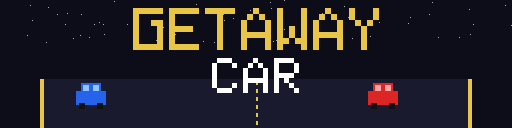
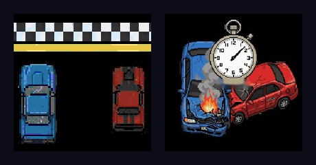

<p align="center"></p>

# Getaway Car: a Two-Player Racing Game on Bare Hardware

A split-screen racing game for two players written in **C for Minix 3**. The game talks to the PC's hardware through **device drivers we wrote ourselves**: timer, keyboard, mouse, video card and real-time clock. It doesn't use any graphics library, game engine or OS input/graphics API.

Developed for the **Computer Laboratory** course (L.EIC018) of the Bachelor in Informatics and Computing Engineering at FEUP (University of Porto), 2025/26.

**Authors:** André Baptista ([@andrefb26](https://github.com/andrefb26)), David Ferreira, Diogo Santos and Leonor Alpoim ([@leonoralpoim](https://github.com/leonoralpoim))

<p align="center"></p>

## The game

- **Two players, one screen:** the screen is split in half. Player 1 steers with the keyboard (`A`/`D` or the arrow keys) and player 2 with the mouse buttons.
- **Two modes:**
  - **Race:** the first to reach the finish line wins.
  - **Endurance:** the track never ends and the last car standing wins.
- **Three biomes:** city, desert and forest, each with its own tiles, scenery and obstacles.
- **Hazards and power-ups:** obstacles, bananas and oil spills (which invert your controls), speed boosts and shields that make the car invulnerable for 5 seconds.
- **Damage model:** each car has 3 lives and visibly goes from normal to damaged, burning and exploded.
- **HUD:** lives, race timer and a minimap.
- **Leaderboard:** results are stored with the date and time read from the RTC.
- Menus (car, biome and mode selection, pause, win screen) can be used with the keyboard or with an on-screen mouse cursor.

<p align="center"></p>

## Architecture

```
                 ┌──────────────── proj.c: interrupt-driven event loop ────────────────┐
 Hardware IRQs ─►│ driver_receive()  →  timer IH (60 Hz) │ keyboard IH │ mouse IH          │
                 └──────────┬──────────────────────────┬───────────────────────────────┘
                            ▼                          ▼
                     controller/              model/                     view/
                     input (scancodes,  ───►  game state machine,  ───►  sprites, HUD and screens
                     mouse packets),          cars, track, obstacles,    drawn into a back buffer,
                     palette, cursor          power-ups, collisions,     then copied to video memory
                                              leaderboard (RTC)          (double buffering)
                            ▲                                                   │
                            └─────────────────── drivers (lab1–lab5) ◄──────────┘
```

- **Event loop:** the timer, keyboard and mouse each subscribe to their interrupt line. One `driver_receive()` loop dispatches the interrupts: the timer drives the game at 60 Hz, and the keyboard and mouse produce input events. Nothing busy-waits.
- **MVC:** the *model* (game state machine, cars, track, obstacles, power-ups, collisions) knows nothing about the hardware. The *view* renders it, and the *controllers* translate raw hardware data into game actions.
- **Graphics:**
  - VBE mode `0x105` (1024×768, 8-bit indexed colour) with a custom 256-colour palette written directly to the VGA DAC (ports `0x3C8`/`0x3C9`);
  - every sprite is an XPM image;
  - frames are rendered into a back buffer and copied to the mapped video memory in one step, to avoid flicker.

## Device drivers (`lab1`–`lab5`)

Each lab builds a static library that the game links against.

| Lab | Device | What the driver does |
|-----|--------|----------------------|
| `lab1` | RTC | reads the date and time from the real-time clock (used by the leaderboard) |
| `lab2` | i8254 timer | configures the timer frequency and handles its interrupts |
| `lab3` | i8042 keyboard controller | reads scancodes (including 2-byte extended codes) through interrupts |
| `lab4` | PS/2 mouse | enables data reporting and assembles 3-byte packets with a state machine |
| `lab5` | video card (VBE) | sets graphics modes, maps physical video memory into the process and draws pixels and XPM sprites |

## My contribution

I wrote device drivers in the labs, and in the game I implemented the **game mode menu** (Race / Endurance), the **win screen** and the **shield power-up**, besides fixing bugs in the game logic.

## Project structure

```
lab1/ … lab5/      device drivers, built as static libraries
proj/
├── Makefile       links the game against the lab libraries
├── Doxyfile       API documentation (Doxygen)
└── src/
    ├── proj.c     entry point and interrupt-driven event loop
    ├── controller/ input, palette, cursor
    ├── model/      game, cars, track, obstacles, power-ups, leaderboard
    ├── view/       screens, HUD and element rendering
    └── assets/xpm/ 150+ sprites (cars, tiles, scenery, UI)
```

About 6,100 lines of C in the game and 1,700 in the drivers.

## Building and running

The project runs inside the **Minix 3 virtual machine** provided by the course, which includes the LCOM framework (`liblcf`).

```bash
# inside the Minix VM
for l in lab1 lab2 lab3 lab4 lab5; do (cd $l && make); done
cd proj && make
lcom_run proj
```

## Technologies

C · Minix 3 · VESA BIOS Extensions · i8254 / i8042 / RTC programming · interrupts · Make · Doxygen · Git
